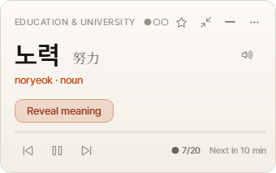
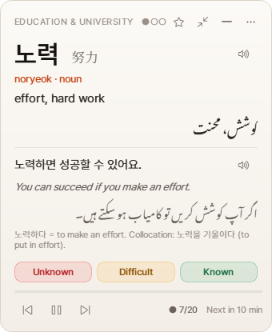
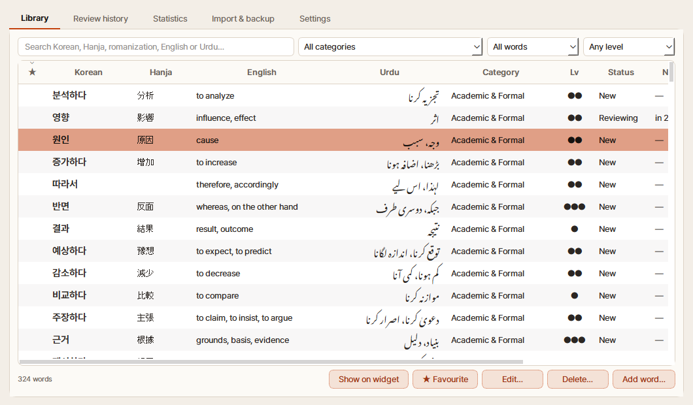
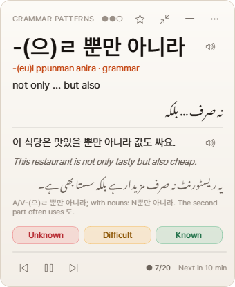
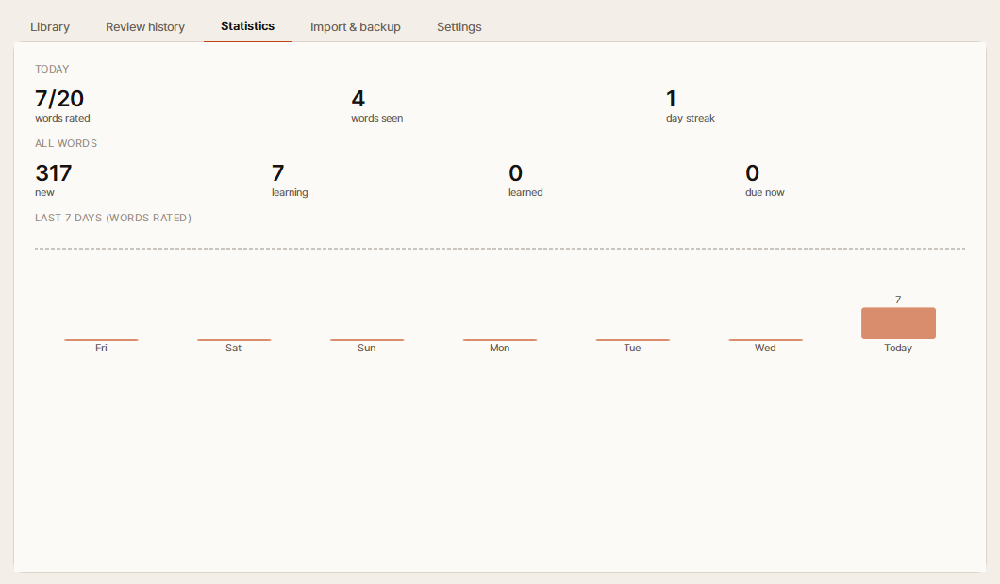
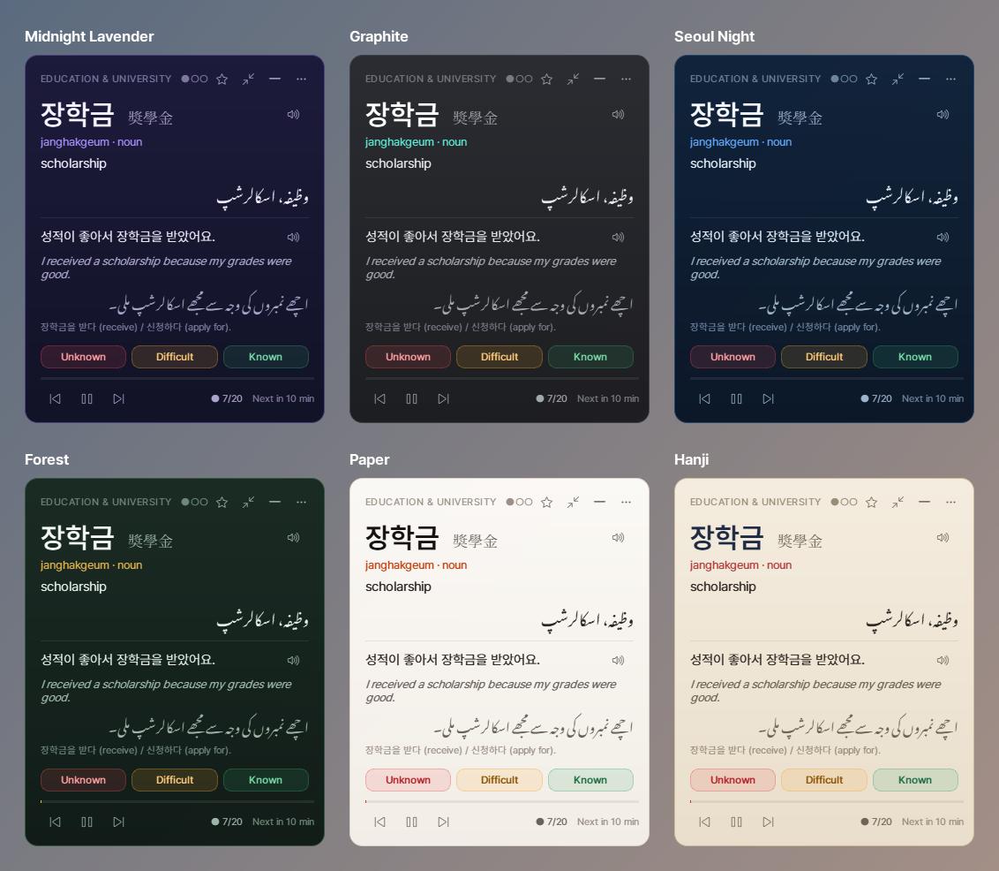

# HangulFlow 한글플로

**Learn Korean vocabulary while you work.** HangulFlow is a small Windows desktop
widget that sits on your desktop and shows one Korean word at a time, with its
meaning in **English and Urdu**, a natural example sentence, Hanja and usage notes.
Rate each word as *Known*, *Difficult* or *Unknown*, and spaced repetition brings
back the words you forget while spacing out the ones you know.

It is built for intermediate learners (around TOPIK 3, aiming for 4+), runs fully
offline, and needs no account or AI service. Internet is only used, optionally,
to download new words once a day.

<p align="center">
  
  &nbsp;
  
</p>

## Features

**On your desktop**
- Stays on the desktop behind your other windows (or, if you prefer, as a normal window or always on top)
- Shows a new word every 1–30 minutes; Previous / Next / Pause controls
- Pauses by itself when the PC is locked, you are away, or a fullscreen app is running
- Compact and detailed modes, adjustable width and opacity, six themes
- Remembers its position and settings; lives in the system tray; optional start with Windows

**Learning**
- Reveal-first cards (recognise the meaning) and reverse cards (recall the Korean), or a mix
- Spaced repetition: *Unknown* returns in 10 minutes, *Difficult* in an hour, *Known* in a day — then the gaps grow
- Daily goal counter, streak, and a 7-day chart
- Korean pronunciation for words and example sentences, using the free voice built into Windows
- Select and copy any text, or copy the whole card

**Content**
- 324 curated cards across 11 categories: education, daily life in Korea, work, society, environment,
  health, travel, emotions, academic language, common verbs and adjectives, and **20 TOPIK 3–4 grammar patterns**
- Every card: Hangul, romanization, part of speech, English and Urdu meanings, a Korean example with
  English and Urdu translations, Hanja for Sino-Korean words, and notes on usage and easily confused words
- Proper Urdu typography (Noto Nastaliq Urdu, right-to-left) and modern Korean typography (Pretendard), bundled

**Library window**
- Search in Korean, Hanja, romanization, English or Urdu; filter by category, level and learning status
- Add, edit, delete and favourite words; review history; statistics
- Import and export CSV (opens in Excel) or JSON
- Automatic daily backups, manual backups, and one-click restore

<p align="center">
  
</p>

<p align="center">
  
  &nbsp;
  
</p>

<details>
<summary>All six themes</summary>

<p align="center"></p>
</details>

## About the vocabulary

The word list is **curated for this project**, not an official TOPIK list. The
difficulty dots (●○○ to ●●●) are editorial estimates, not official TOPIK levels.
Meanings and translations were written with care, but if you spot a mistake,
please open an issue or correct it in the library window. Your edits are kept,
even when the built-in list is updated.

**New words online.** Once a day HangulFlow downloads the latest
`hangulflow/resources/seed_vocabulary.json` from this repository. When its
`version` number is higher than the one you have, new words are added and
unedited words get any corrections. Nothing about you is sent, and without
internet the app simply keeps working offline. Turn it off with right-click →
**Get new words online (daily)**. To publish new words, add entries to that
file, raise `version` by one and push.

## Install and run

### Option A: the installer (recommended, no Python needed)
1. Run `HangulFlow-Setup-<version>.exe` (see *Build the installer* below).
   It installs for your Windows account only, so no administrator rights are needed.
2. Choose whether to add a desktop shortcut and start HangulFlow at sign-in.
3. Start it from the Start menu. Uninstall from **Settings → Apps**; your words and
   progress in `%LOCALAPPDATA%\HangulFlow` are kept.

Windows may show "Windows protected your PC" because the installer is not code-signed:
click **More info → Run anyway**.

### Option B: from source
Requires Windows 10/11 and [Python 3.13](https://www.python.org/downloads/) from python.org.
The Microsoft Store version of Python redirects app data to a private folder, so the python.org version is recommended.

```powershell
git clone https://github.com/amanullah-rao/HangulFlow.git
cd HangulFlow
py -3.13 -m venv .venv
.\.venv\Scripts\python.exe -m pip install -r requirements.txt
.\.venv\Scripts\python.exe main.py
```

### Korean pronunciation (optional)
HangulFlow uses the Korean voice that comes with Windows. If the 🔊 button says no
voice is installed: **Settings → Time & language → Speech → Add voices → 한국어 (Korean)**.
Everything else works without it.

## Using HangulFlow

| Action | How |
|---|---|
| Reveal the meaning | Click the word, the **Reveal** button, or press **Space** |
| Rate a word | **Unknown / Difficult / Known** buttons, or keys **1 / 2 / 3** |
| Next / previous word | **→ / ←** or the buttons at the bottom |
| Pause rotation | **P** or the pause button |
| Hear the word | 🔊 button or **S** |
| Copy | Select text and press **Ctrl+C**, or right-click → *Copy word / Copy whole card* |
| Move / resize | Drag the top or bottom bar; drag the left or right edge |
| Settings, library, statistics | Right-click the card, or use the 한 icon in the system tray |
| See the card when windows are open | Press **Win+D** (show desktop) |

Your data lives in `%LOCALAPPDATA%\HangulFlow` (database, settings, daily backups
and logs). Right-click → **Open data folder** takes you there.

## Development

```powershell
.\.venv\Scripts\python.exe -m pip install -r requirements-dev.txt
.\.venv\Scripts\python.exe -m pytest -q            # run the tests
.\.venv\Scripts\python.exe tools\make_screenshots.py  # refresh README screenshots
```

Set `HANGULFLOW_DATA_DIR` to a temporary folder to experiment without touching your real progress.

```
hangulflow/
  app.py            start-up: logging, single instance, database, widget, tray, library
  srs.py            spaced-repetition scheduling (pure, tested)
  rotation.py       which word comes next (pure, tested)
  repository.py     all SQL: words, progress, history, statistics, import/export
  database.py       SQLite schema and migrations
  backup.py         daily / manual backups and restore
  presence.py       away / locked / fullscreen detection (Win32)
  startup.py        optional launch at Windows sign-in
  updater.py        optional daily download of a newer word list
  ui/               desktop card, library window, dialogs, themes, speech, tray
  resources/        curated word list and bundled fonts
tests/              pytest suite
tools/              icon and screenshot generators
```

### Build the .exe

```powershell
.\.venv\Scripts\python.exe -m pip install -r requirements-dev.txt
.\.venv\Scripts\python.exe -m PyInstaller hangulflow.spec --noconfirm --clean
dist\HangulFlow\HangulFlow.exe --self-test
```

The build is written to `dist\HangulFlow\` (about 90 MB). `--self-test` checks
the fonts, the database and Korean speech, and writes the result to
`self-test.txt` in the data folder.

### Build the installer

Install [Inno Setup 6](https://jrsoftware.org/isinfo.php), build the .exe as above, then:

```powershell
& "$env:LOCALAPPDATA\Programs\Inno Setup 6\ISCC.exe" installer\hangulflow.iss
```

This writes `dist\HangulFlow-Setup-<version>.exe` (about 27 MB), a single file
you can copy to any Windows 10/11 PC. Keep `AppVersion` in the script equal to
`__version__` in `hangulflow/__init__.py`.

## License

HangulFlow's code and curated vocabulary are released under the [MIT License](LICENSE).
Bundled fonts (SIL Open Font License) and Qt / PySide6 (LGPL-3.0) keep their own
licenses; see [THIRD_PARTY_NOTICES.md](THIRD_PARTY_NOTICES.md).
